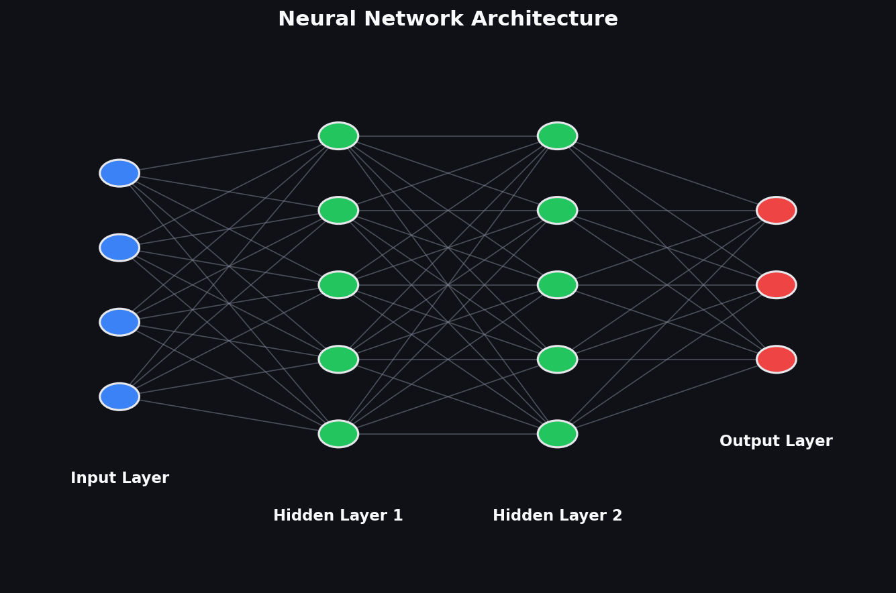
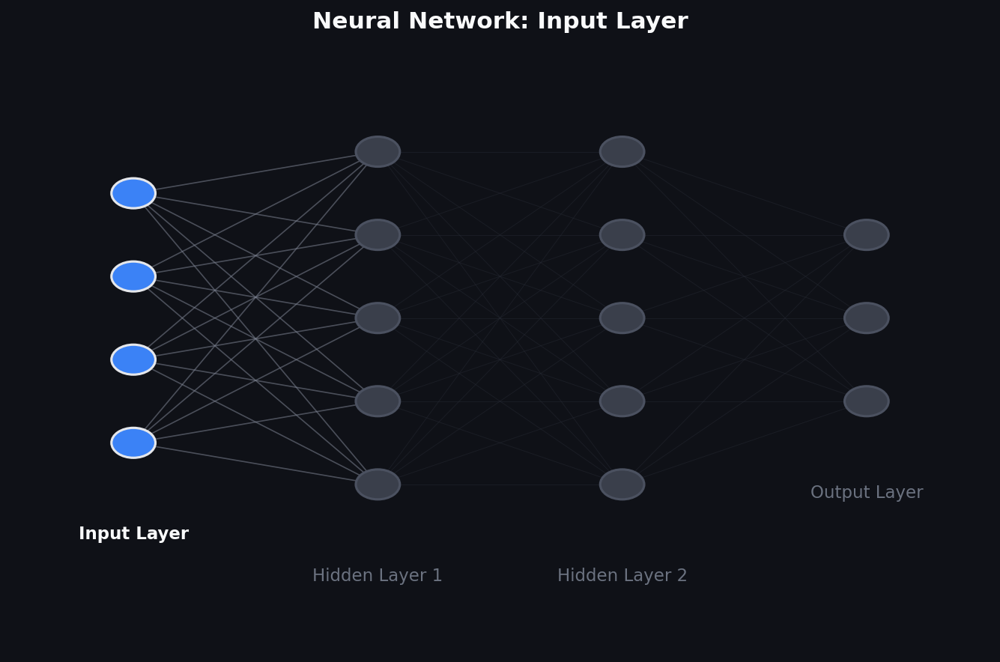
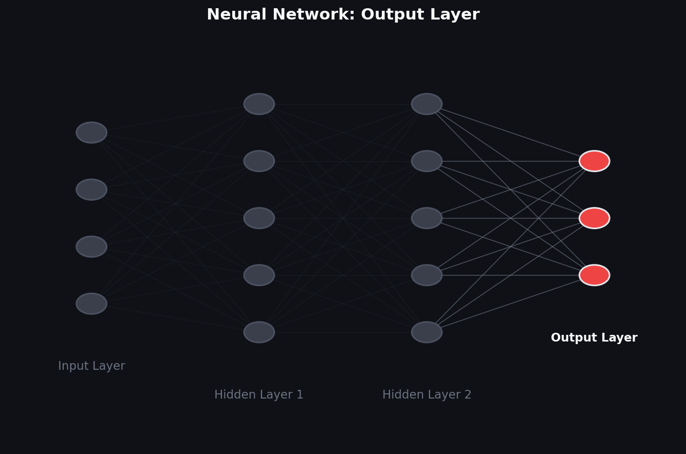
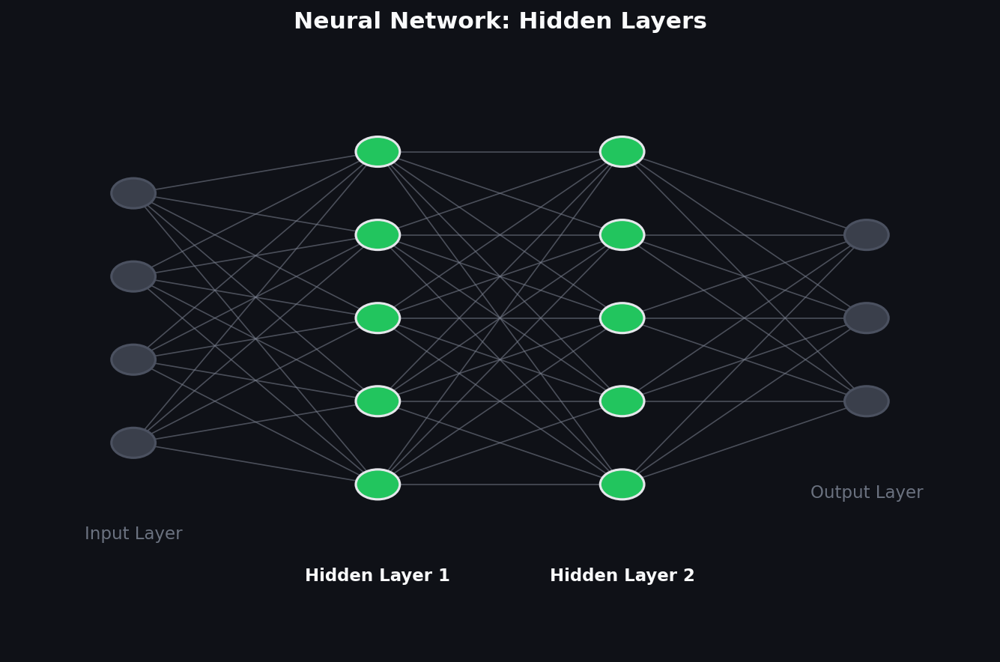

Everyone who's ever dipped a toe into machine learning or tried to learn about AI has probably heard of a neural network. But what actually is a neural network, and how does the machine learn? 
I feel like I should be able to explain that and so as an exercise decided to take a crack at it in my own words — partly to help myself really understand it, partly in case it helps someone else too.


## What Is a Neuron?

At its core, a neuron is a node for passing signals. 

{: .align-center}


In the human brain, it's a cell that receives an electrical impulse and transmits that inpulse to nearby neurons. In machine learning, it's a function, it takes an input transforms it and passes the output to other neighboring neurons.

A simplified neuron can be represented by the following function:

\\[
y = w_1x_1 + w_2x_2 + \dots + w_nx_n + b
\\]

That weighted sum is the raw signal a neuron computes from its inputs and passes to it's neighboring neurons as input. 
Depending on how the network is trained, that sum could represent litterally anything: 
- how "cat-like" an image looks 
- How much static in an audio clip resembles rain vs a crowd
- Or it could represent nothing interpretable at all! Just some tangled combination of edges, textures, and statistical quirks that only makes sense in combination with a thousand other neurons.

An individual neuron essentially captures a vibe that will nudge the network in the right direction.


## Neuron Layers

Much like Ogres, Neural Networks have layers.

You may have guessed this by now, but a single neuron itself isnt very powerful. The human brain contains 86 billion neurons for a reason. 

When you touch something, hear something, see something, your related sensory cells provide input to the the related neurons. Depending on how they've learned to interpret those signals those neurons begin firing and sending signals to their neighbors. Causing a cascade of information we understand as thought. 

A Neural network copies this idea in a more 2 dimensional fashion. Instead of a 3-dimensional cloud of neighboring neurons we create inter-connected layers of neurons.



> We are only talking about basic Neural networks here, I'll talk about layerless and sparse neural networks in another post. 
More complex network architectures like NEAT and BDH, connect neurons more similarly to an organic brain 

### The Input Layer

A bio neuron takes an electrical impulse delivered from a sensory organ like your eyes, ears, nose, or skin. This input helps our brain perceive the world outside our body and decide how to react. 

Much the same way, an artificial neuron receives input from us. When building the neural network we define what the input represents: pixels, words, categories, board-state whatever the problem calls for. These are typically refered to as features.



This is the input layer, our set of neurons that take input from whatever observable variables we are trying to use to inform the machines decision. As the entry point for the network each neuron is responsible for taking input from only a single feature.

### The Output Layer
The Output layer is the group of Neurons that map to the result of our machines decision. Just like the input we need 1 neuron for every variable we are expecting to get. This is the networks final answer: a classification, a predicted value, a decision, a word, a group of settings. This is the moment the raw sensory noise has been distilled down to a single conclusion. 



### The Hidden Layers
Hidden Layers sit between input and output. This is where the real work happens: each layer takes what the previous layer handed it and combines it into something more abstract. Raw pixels become edges, edges become shapes, shapes become object parts. This is where the neurons really start to lose their identity and instead start representing vibes.



## The Activation Function

A bio neuron doesn't just pass its input along untouched. It decides when to fire based on how strong and how frequently the incoming signal is received.
That decision is nonlinear, a neuron may learn to hold back or fire with strength not proportional to the input or do something else.

This non-linearity is very important.
Consider the layers of neurons we've introduced: if every neuron were just a weighted sum (`y = wx + b`), stacking layers wouldn't capture non-linear behavior very well and we would run into issues during training. Mathematically, stacking linear functions will always result in a linear function so the network won't be able to answer correctly if the answer doesn't follow a straight line or flat plane from the input.

An **activation function** is the fix. It takes a neuron's raw weighted sum and decides how much of it actually gets passed on to the next layer critically, it does that in a non-straight-line way. Bend the signal even a little at every single neuron, and stacking layers stops being pointless: each layer can bend the data a bit further than the last, until the network can approximate wildly complicated shapes instead of just straight lines and flat planes.

For a single neuron, the fuller computation looks like this:

```
output = activation(w₁x₁ + w₂x₂ + ... + wₙxₙ + b)
```

A couple of the popular choices for how a neuron "decides to fire":

{: .align-center}

- **Sigmoid** — squashes anything into a smooth range between 0 and 1. Closer to how a biological neuron gradually ramps up its firing rate.
- **ReLU** — much blunter: if the signal's negative, fire nothing; if it's positive, pass it through untouched. Dumber than sigmoid, but it turns out to work great in practice, and it's cheap to compute.

Either way, the effect is the same: every neuron gets a little bit of "personality" in how it reacts, and that's what gives the whole network the flexibility to learn something more interesting than a straight line.

## Training

Now that we know what a network looks like structurally, how does it actually learn to do anything? Right now, every weight in this thing is just a random number. A freshly initialized network is basically all noise.

Training is the process of nudging those weights from "random garbage" to "something useful," one example at a time. Show the network an input, look at what it guessed, compare that to the answer you actually wanted, and adjust the weights that were responsible for the mistake. Do that enough times across enough examples and the noise starts to organize itself into something that reacts correctly.

The question is: how do you set the weights so that the network produces useful outputs?

### The Loss Function

You can't set weights by hand for anything beyond a toy problem. Instead, you define a **loss function** — a number that quantifies how wrong the network's final outputs are and then you work to minimize that loss.

For regression, that's often mean squared error and for classification, it's usually cross-entropy loss. As the problem being solved gets more abstract the loss function tends toward some quantifiable part of the output. ie. blunders in a game of chess, score in a video game.

The details vary, but the point is the same: a loss of zero means perfect predictions; higher loss means worse predictions. Your goal is to find the weights that minimize this number.

### Optimizing

At a high level, optimizing a network comes down to the same loop every time: run an example through, check how wrong the output was with the loss function, then nudge every weight a little in whatever direction reduces that wrongness. Do that enough times over enough examples and the weights settle into something useful.

Two ideas do most of the work here: **gradient descent** and **backpropagation**.

- **Gradient descent** is the "which way is downhill" part. Picture the loss as a landscape shaped by every weight in the network — gradient descent just takes small steps downhill, toward whatever combination of weights produces the lowest loss.
- **Backpropagation** is how you figure out which direction is downhill for every single weight, even in a network with millions of them. It works backward from the loss, layer by layer, handing each weight its fair share of the blame for the error.

Backprop tells you which way to nudge each weight, gradient descent actually takes the step.
That's the basic shape of it: test, measure, nudge, repeat.

### Over fitting
One last important point to mention in regards to training is **Over fitting**. **Over fitting** is probably the most common pitfall in machine learning when you are getting started. It happens when a model gets too caught up in reducing loss during training. 

The model learns the patterns present in the training set instead of how to generalize to the problem. The model simply memorizes the answers to the test rather than how to solve the question.

To keep things simple i'll stop here and save the math and practical explanation for another post.


## Wrapping Up

I think Neural networks are so incredibly interesting, they are a fundamental piece of most modern machine learning algorithms/models. When people talk about training a model or AI they are almost always talking about tuning and optimizing the weights in a neural network. 

So to summarize; neural networks are really just cascading layers of simple linear functions (nodes). They learn by trial and error adjusting the weights of their functions. Running training loops of test, validate, nudge, repeat.

Thanks for reading this far and humoring me in this exercise. 

---
*Questions or corrections? Connect with me on [LinkedIn](https://www.linkedin.com/in/andrew-munro-west/).*
